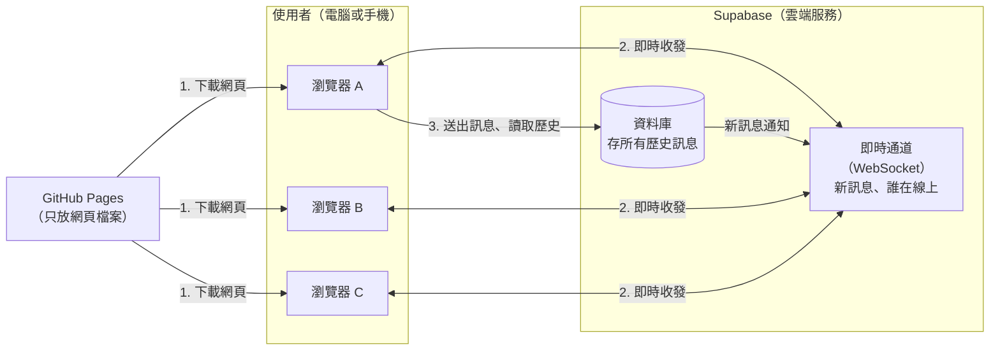

# 匿名聊天室：架構文件

> 這份文件寫給「不寫程式的人」。第一次出現的專有名詞，後面會用一句話解釋。

---

## 1. 專案說明與目標

**這是什麼**：一個不用註冊、不用登入的匿名聊天室。所有人都在同一個聊天室裡。任何知道網址的人，用電腦或手機都能進來。

**使用者會怎麼用**
1. 打開網頁
2. 輸入一個代號（只能英文和數字，最多 12 個字）
3. 進入聊天室，看到所有歷史訊息、看到誰在線上，也可以送出文字或圖片連結

**這一版的目標**
- 先做出一個可以在網路上看到的前端畫面（階段一）
- 再接上真正的即時傳訊功能（階段二）
- 整個專案不需要自己架伺服器，也不用付費

**已經決定的使用者體驗**（來自前面的訪談）

| 項目 | 決定 |
|---|---|
| 代號重複 | 擋下來，請對方換一個 |
| 歷史訊息 | 新加入的人看得到全部 |
| 訊息顯示 | 代號、時間；自己的訊息靠右，別人的靠左 |
| 訊息內容 | 純文字，加上圖片連結（會直接顯示成圖片） |
| 送出方式 | 只能按「送出」按鈕，Enter 鍵是換行 |
| 離開提示 | 聊天區出現系統提示；短暫斷線（例如手機切到別的 App）不顯示加入或離開 |
| 重新整理網頁 | 輸入框會預先填好上次的代號，但仍要按一下「進入」 |
| 新訊息捲動 | 在最底部時自動捲到最新；正在往上翻舊訊息時，不強制捲動，改顯示「有新訊息 ↓」按鈕 |
| 線上名單 | 手機上收合成「線上 N 人」，點了展開；電腦上固定顯示在側邊 |
| 外觀 | 跟隨使用者裝置的設定，自動切換明亮與深色 |
| 自訂顏色 | 使用者可以自訂「主色」（自己的訊息泡泡、送出與進入按鈕）；有幾個預設色、一個自選色、可恢復預設；只記在自己的瀏覽器，別人看不到 |
| 斷線 | 頂端顯示「連線中斷，重新連線中…」；連上後自動補上漏掉的訊息；送出失敗的訊息標示「未送出」，點一下可重送 |

---

## 2. 整體架構圖

三個角色：

- **瀏覽器**：使用者眼前的網頁，負責畫面和操作。
- **GitHub Pages**：GitHub 提供的免費網頁空間，只負責把網頁檔案交給瀏覽器，**不處理任何聊天內容**。
- **Supabase**：一個現成的雲端服務，負責「記住訊息」和「即時把訊息傳給所有人」。



**怎麼讀這張圖**
1. 使用者打開網址，瀏覽器從 GitHub Pages 下載網頁。
2. 網頁載入後，直接和 Supabase 建立一條「即時通道」。**WebSocket** 是一種讓網頁和伺服器保持連線的技術，有新訊息時伺服器能主動推給你，不用一直重新整理。
3. 送出訊息時，訊息寫進 Supabase 的資料庫；資料庫一收到，就通過即時通道通知所有人。歷史訊息也從資料庫讀取。

階段一時，右邊的 Supabase 還不存在，網頁會用假資料自己模擬（見第 4 節）。

---

## 3. 技術選擇

### 3.1 前端：Vite + TypeScript，不使用大型框架

- **選了什麼**
  - **TypeScript**：一種寫網頁程式的語言，比一般 JavaScript 多了「資料格式檢查」，能提早抓到錯誤。
  - **Vite**：一個打包工具，把我們寫的程式整理成瀏覽器能直接用的靜態檔案。
  - 不使用 React、Vue 之類的「框架」（幫忙組織大型網頁的工具包）。
- **為什麼**
  - 這個網頁只有兩個狀態：「輸入代號」和「聊天室」，沒有複雜的頁面跳轉，用框架反而增加不必要的複雜度。
  - Vite 輸出的是純靜態檔案，正好符合 GitHub Pages 只能放靜態檔案的限制。
  - 外觀用原生 CSS（網頁樣式語言）就能做到明亮和深色自動切換，不需要額外工具。

### 3.2 訊息的儲存：Supabase 資料庫

- **選了什麼**：Supabase 的資料庫功能（底層是 PostgreSQL，一種常見的資料庫），建一張叫 `messages` 的表存所有訊息。
- **為什麼**：需求要求「新加入的人看得到全部歷史訊息」，所以訊息必須永久保存，不能只存在瀏覽器裡。

### 3.3 即時收新訊息：Supabase Realtime

- **選了什麼**：Supabase 的 **Realtime** 功能。資料庫一多出一則訊息，它就自動通知所有在線的瀏覽器。
- **為什麼**：不需要自己寫「廣播給所有人」的程式，省事也不容易出錯。

### 3.4 誰在線上：Supabase Presence

- **選了什麼**：Realtime 裡的 **Presence**（在線狀態）功能。每個瀏覽器進來時登記自己的代號，離開時自動被移除。
- **為什麼**
  - 它專門解決「誰在線上」。使用者直接關掉網頁、手機沒電、網路斷掉，它都能判斷這個人已經離線，不需要我們自己處理。
  - 線上狀態是暫時的，不需要存進資料庫。

### 3.5 沒有選的東西

- **不使用登入功能（Supabase Auth）**：需求就是不登入。
- **不自己架伺服器**：Supabase 已經包辦，維護成本最低。

---

## 4. 兩個階段，以及如何不用重寫

### 4.1 階段一：先做前端，不接 Supabase

**要做到什麼程度**：整個聊天室的畫面和操作都完整可用，只是資料是「假的」，由前端自己模擬：

- 輸入代號、檢查格式、擋掉「重複代號」（用假的在線名單測試）
- 進入聊天室後，看到一批假的歷史訊息
- 自己送出的訊息會出現在畫面上（靠右），並模擬「傳送中、已送出、未送出可重送」三種狀態
- 模擬其他人定時發言、加入、離開，用來測試提示和線上名單
- 模擬「連線中斷、重新連線」的畫面
- 往上滑載入更多舊訊息、「有新訊息 ↓」按鈕
- 手機與電腦版面、明亮與深色模式

**怎麼在 GitHub Pages 上看到**：把前端建置後的檔案發佈到 GitHub Pages（做法見第 12 節）。完成後，任何人打開網址都能操作這個「示範版」。

**限制**：因為資料是假的，兩個人同時打開網頁看不到彼此，訊息只存在自己的畫面上。

### 4.2 階段二：接上 Supabase

階段二只改變「資料從哪裡來」：

| 項目 | 階段一 | 階段二 |
|---|---|---|
| 歷史訊息 | 假資料 | Supabase 資料庫 |
| 送出訊息 | 只出現在自己畫面 | 寫進資料庫，所有人都收到 |
| 誰在線上 | 模擬 | Supabase Presence |
| 代號重複 | 對照假名單 | 對照真正的在線名單 |
| 斷線 | 手動模擬 | 真正偵測網路狀態 |

### 4.3 如何避免整個重寫

做法是在「畫面」和「資料來源」中間放一道**固定的介面**（可以想成插座規格）：

- 畫面部分的程式，只透過這個介面問問題：「給我歷史訊息」「我要送這則訊息」「現在誰在線上」，並接收「有新訊息」「有人加入」之類的通知。畫面**完全不知道**資料是真的還是假的。
- 階段一，介面後面接「模擬資料來源」。
- 階段二，換成「Supabase 資料來源」。兩者遵守同一份規格（第 5 節），所以畫面程式不用改。

---

## 5. 通訊約定

畫面和資料來源之間用「事件」溝通。事件就是「發生了某件事」的通知，每種事件有固定名稱和資料格式。

### 5.1 資料來源會通知畫面的事件

| 事件名稱 | 什麼時候發生 | 帶的資料 |
|---|---|---|
| `message:new` | 有一則新訊息（別人的，或自己送出成功確認） | 一則訊息 |
| `presence:sync` | 取得或更新完整的在線名單 | 在線者清單 |
| `presence:join` | 有人加入 | 一位在線者 |
| `presence:leave` | 有人離開 | 一位在線者 |
| `connection:status` | 連線狀態改變 | 狀態：`connected`（已連線）、`reconnecting`（重連中）、`offline`（離線） |

### 5.2 畫面可以對資料來源下的指令

| 指令名稱 | 做什麼 | 回傳 |
|---|---|---|
| `join` | 用代號進入聊天室 | 成功，或失敗原因（代號格式錯誤、代號已被使用、連線失敗） |
| `leave` | 離開聊天室 | 無 |
| `loadLatest` | 取得最新 50 則歷史訊息 | 訊息清單，並告知是否還有更舊的 |
| `loadOlder` | 取得比目前最舊的那則更早的 50 則 | 訊息清單，並告知是否還有更舊的 |
| `loadAfter` | 斷線重連後，取得某個編號之後漏掉的訊息（第 6.4 節的「補訊息」） | 訊息清單 |
| `send` | 送出一則訊息 | 成功，或失敗原因 |

### 5.3 資料格式

**一則訊息**

| 欄位 | 意思 | 範例 |
|---|---|---|
| `id` | 資料庫給的流水號，數字越大越新；傳送中尚未取得時為空 | `1024` |
| `clientMsgId` | 前端為每則訊息隨機產生的唯一編號，用來在重送時避免變成兩則 | `"b7e2…"`（一串隨機字元） |
| `nickname` | 發送者代號 | `"Amy01"` |
| `body` | 訊息文字 | `"大家好"` |
| `createdAt` | 發送時間，由資料庫決定（不採用使用者裝置的時間，避免被亂改） | `2026-10-13 14:32` |
| `sendState` | 只存在前端：`sending` 傳送中、`sent` 已送出、`failed` 未送出 | `"sent"` |

**一位在線者**

| 欄位 | 意思 |
|---|---|
| `nickname` | 代號 |
| `clientId` | 每個瀏覽器分頁自己產生的隨機編號，用來辨識「這是同一個人短暫斷線後回來」。**它不是身分，也不會被存起來**。 |
| `joinedAt` | 進入時間，用來在兩人同時搶同一個代號時判斷誰先 |

**系統提示**（只在畫面上顯示，不存進資料庫）

| 欄位 | 意思 |
|---|---|
| `type` | `join`（加入）或 `leave`（離開） |
| `nickname` | 是誰 |

系統提示在畫面上只顯示文字，不顯示時間。

---

## 6. 資料流：各種情境發生什麼事

### 6.1 進入聊天室

1. 使用者打開網頁，輸入框預先填好上次用過的代號（瀏覽器自己記的，沒有就留空）。
2. 按「進入」。前端先檢查格式：只能英文和數字、1 到 12 個字。不合格就在輸入框下方提示。
3. 前端查看目前在線名單。代號**不分大小寫**，例如 `Amy01` 和 `amy01` 視為同一個。如果代號已有人使用，提示「這個代號有人用了，請換一個」，停留在輸入畫面。
4. 通過的話，記住這個代號供下次預填，登記為在線者，載入最新 50 則歷史訊息，顯示聊天室。
5. 其他人的畫面會收到「某某加入了」。

> **兩人同時搶同一個代號**：兩個人幾乎同一瞬間按「進入」，系統可能都放行。所以登記為在線者之後，會先等約 1 秒讓大家的名單同步，**在真正進入聊天室之前**再核對一次：如果發現同代號有兩人，進入時間較晚的那位不會進入，直接留在輸入畫面並提示換代號。超過這約 1 秒才出現的重複，不會再處理，這是盡力處理，不保證完全零誤差。因此按下「進入」後，可能要等 1 到 2 秒才會進入聊天室。

### 6.2 送出訊息

1. 使用者按「送出」按鈕（Enter 只是換行）。內容是空的，或超過上限時，按鈕不能按。
2. 訊息立刻出現在自己畫面上，標示「傳送中」。
3. 訊息寫進資料庫。成功後，系統收到新訊息通知，標示變成「已送出」。
4. 如果失敗（例如網路斷了）：標示「未送出」，使用者點一下就重送。重送使用同一個 `clientMsgId`，所以就算第一次其實已成功，也不會出現兩則。
5. 其他人在畫面上看到這則訊息；如果對方停在底部就自動捲到最新，如果對方正在翻舊訊息，則出現「有新訊息 ↓」按鈕。自己送出的訊息，自己永遠會捲到最底。

### 6.3 離開

1. 使用者關掉網頁，或網路斷掉太久。
2. 系統偵測到這個人不在了，其他人的線上名單**立即**移除他。
3. 聊天區的「某某離開了聊天室」提示會**等約 10 秒**再出現。如果這 10 秒內同一個人回來了（例如手機切到別的 App 又切回來），就不顯示任何離開或加入的提示。
4. 這樣避免手機使用者頻繁切換時，聊天區被「離開、加入、離開、加入」洗版。

### 6.4 斷線與重新連線

1. 網路中斷時，畫面頂端出現「連線中斷，重新連線中…」。已經在畫面上的訊息保持不動。
2. 這段期間如果訊息送不出去（網路確實斷了，或寫入失敗），就標示「未送出」，使用者可以點一下重送。如果只是即時通道在重連、網路其實是通的，訊息會直接送出成功。
3. 網路恢復後，系統自動重新連線，提示消失。
4. 然後自動補上斷線期間漏掉的訊息（找出手上最新的一則，向資料庫要它之後的所有訊息），並重新登記為在線者。
5. 手機從背景切回前景，視同一次斷線再重連，走同一個流程。

---

## 7. 畫面清單

這一節只寫「有什麼元素、各自做什麼」。顏色、字體、間距、動畫由 `/design` 負責。

### 7.1 畫面一：進入畫面

| 元素 | 行為 |
|---|---|
| 標題與簡短說明 | 說明這是匿名聊天室 |
| 代號輸入框 | 預先填好上次的代號；限制英文和數字、最多 12 字；輸入不合規定的字元時給提示 |
| 「進入」按鈕 | 按下後檢查代號；格式不對或已被使用時，不進入，並顯示原因；檢查期間按鈕顯示處理中，防止連按 |
| 錯誤提示 | 顯示在輸入框附近，說明「格式不對」或「這個代號有人用了，請換一個」 |

### 7.1.1 兩個畫面共用：自訂顏色

| 元素 | 行為 |
|---|---|
| 調色盤按鈕 | 進入畫面固定在右上角，聊天室畫面在頂部列；按一下開關面板，按 Esc 或點面板外也會關閉 |
| 預設主色 | 六個預設色，目前使用的有選取標記；選了立刻套用 |
| 自選顏色 | 用瀏覽器內建的取色器挑任何顏色，立刻套用；系統會自動決定主色上的文字用白色或深色，確保看得清楚 |
| 恢復預設 | 回到原本的青綠色 |
| 記憶 | 選擇存在這個瀏覽器的 `localStorage`，下次打開網頁自動套用；換裝置或清除瀏覽器資料就回到預設。不會傳給別人，也不碰 Supabase |

### 7.2 畫面二：聊天室

**頂部列**

| 元素 | 行為 |
|---|---|
| 聊天室名稱 | 固定文字 |
| 「線上 N 人」 | 手機上點一下展開或收合線上名單；電腦上只是顯示人數 |
| 連線狀態提示 | 連線中斷時顯示「連線中斷，重新連線中…」，恢復後自動消失 |

**線上名單**

| 元素 | 行為 |
|---|---|
| 在線者代號清單 | 有人加入或離開時即時更新；自己的代號有標記。電腦版固定在側邊；手機版是點開才出現的浮層，再點一次或點旁邊可關閉 |

**訊息區**

| 元素 | 行為 |
|---|---|
| 訊息泡泡 | 別人的靠左、自己的靠右；每則顯示代號與時間（例如 14:32）；內容有網址是圖片時，直接顯示成圖片 |
| 圖片 | 有大小上限；載入失敗時退回顯示網址文字 |
| 傳送狀態 | 自己的訊息顯示「傳送中」；失敗時顯示「未送出」，點一下重送 |
| 系統提示 | 置中顯示「某某加入了聊天室」「某某離開了聊天室」，外觀與一般訊息明顯不同 |
| 往上捲載入舊訊息 | 捲到頂端時自動載入更早的 50 則，畫面位置不會跳走；沒有更舊的訊息時顯示「已經是最早的訊息」 |
| 「有新訊息 ↓」按鈕 | 只在使用者正往上翻舊訊息、而又有新訊息進來時出現；點了跳到最新並消失 |
| 自動捲動 | 使用者停在最底部時，新訊息進來自動捲到最新 |

**輸入區**

| 元素 | 行為 |
|---|---|
| 多行文字框 | Enter 換行，不會送出；有字數上限，接近上限時顯示剩餘字數 |
| 「送出」按鈕 | 內容空白或超過上限時不能按；按下後清空文字框並顯示「傳送中」 |

---

## 8. 金鑰

**金鑰**是一段文字，像鑰匙一樣，讓你的網頁有權限跟 Supabase 溝通。

### 8.1 這個專案會用到什麼

| 名稱 | 用途 | 能不能公開 |
|---|---|---|
| **專案網址（Project URL）** | 告訴網頁 Supabase 在哪裡 | 可以公開 |
| **anon key（也叫 publishable key，公開金鑰）** | 讓網頁以「一般訪客」身分讀取與寫入訊息 | **可以公開**，設計上就會出現在網頁裡 |
| **service_role key（管理金鑰）** | 擁有 Supabase 專案的完全控制權，可以繞過所有保護 | **絕對不能公開**，這個專案**完全用不到**，也不應該拿到前端或放進 repo |
| **資料庫密碼** | 建立專案時設定，用於直接連線資料庫 | **絕對不能公開**，這個專案的網頁不會用到 |

### 8.2 怎麼產生

1. 到 Supabase 網站註冊並建立一個專案；建立時會要你設定資料庫密碼，把它存在你自己的密碼管理工具裡。
2. 專案建好後，在專案設定的 API 頁面可以看到「Project URL」和「anon key」，複製這兩個。
3. 同一頁面也會看到 `service_role key`，**不要複製、不要貼到任何地方**。

### 8.3 放在哪裡

| 情境 | 放哪裡 |
|---|---|
| 自己的電腦開發時 | 專案資料夾裡一個叫 `.env.local` 的檔案（見下方防 commit） |
| 部署到 GitHub Pages 時 | GitHub 專案設定裡的 Actions Variables（讓自動部署流程在建置網頁時帶入這兩個值） |

### 8.4 為什麼公開金鑰可以公開

網頁的程式會被下載到每位使用者的瀏覽器，**任何人都能看到網頁裡的內容**，所以放在前端的東西本來就藏不住。真正的保護來自 Supabase 資料庫的規則（RLS，第 9 節）：就算別人拿到 anon key，也只能做規則允許的事：讀訊息和新增訊息，不能修改、刪除。

### 8.5 怎麼避免被 commit 到 GitHub

- **commit** 是把檔案存進 git 版本紀錄並可推送到 GitHub 的動作；一旦推上去，即使之後刪除，歷史紀錄裡仍找得到。
- 做法：
  1. 在 `.gitignore`（告訴 git「這些檔案不要追蹤」的清單）加入 `.env.local`，讓它永遠不會被 commit。
  2. 在 repo 提供一個 `.env.example`，只寫變數名稱和假的範例值，讓別人知道要填什麼。
  3. 每次 commit 前用 `git status` 檢查要提交的檔案清單。
- 萬一誤傳了 `service_role key` 或資料庫密碼：立刻到 Supabase 重新產生（讓舊的失效），不要只是刪掉檔案。

---

## 9. 安全與限制

### 9.1 別人可能送什麼奇怪的東西，前端怎麼擋

> 前端的檢查是為了使用體驗；真正的把關在資料庫端（見 9.2），因為有心人可以繞過網頁直接送資料。

| 可能的狀況 | 前端怎麼處理 |
|---|---|
| 訊息裡夾帶網頁程式碼（例如 `<script>…</script>`），企圖在別人的瀏覽器執行 | 所有訊息和代號一律當成**純文字**顯示，絕不當成網頁語法解讀，所以不會被執行 |
| 圖片連結指向惡意網址或非圖片 | 只有 `https://` 開頭、並以 `.jpg`、`.jpeg`、`.png`、`.gif`、`.webp` 結尾的網址才會顯示成圖片，其他都只當文字顯示 |
| 圖片主機追蹤觀看者 | 載入圖片時不帶出自己的來源網址資訊；圖片只在進入畫面時才載入。但「圖片主機看得到你的 IP」是顯示外部圖片本身無法避免的代價 |
| 超長訊息、一大堆空白 | 限制長度上限 2000 字；全是空白的訊息不允許送出 |
| 代號亂填（符號、表情符號、超長） | 只接受英文和數字、最多 12 字 |
| 冒用別人的代號 | 同一時間在線者代號不能重複（不分大小寫）；但對方離線後，別人就可以用他的代號，所以**代號不能代表身分**。畫面是用「代號是否和我的相同」判斷哪些訊息是「我的」（靠右顯示），所以接手同一個代號的人，會把那個代號以前的訊息也看成自己的。這是匿名、不登入的已知限制 |
| 連續洗版 | 這一版**不處理**（見第 10 節） |

### 9.2 資料庫端的保護

- 用 **RLS（Row Level Security，資料列安全規則）** 限制匿名訪客：只能「讀取」和「新增」訊息，不能修改或刪除任何一則。
- 資料庫對代號格式、訊息長度也設規則，不符合直接拒收，就算有人繞過網頁也一樣。

### 9.3 免費方案的上限（需注意）

> 以下是類型與大致說明；**具體數字請以各服務官方的最新定價頁為準**，會調整。

| 服務 | 要注意的限制 |
|---|---|
| **Supabase 免費方案** | ① 資料庫儲存空間有上限，歷史訊息會永久累積，聊太久可能滿。② 同時在線的即時連線人數有上限。③ 每秒可傳的即時訊息數量有上限。④ **專案閒置一段時間（目前約一週沒有使用）會被自動暫停**，暫停期間聊天室無法使用，需要到後台手動恢復。⑤ 免費方案通常沒有自動備份保證。 |
| **GitHub Pages** | 網站大小與每月流量有額度；免費方案要求 repo 是公開的（程式碼別人看得到，所以前面強調不能放私密金鑰）。 |

這是小型聊天室，通常不會碰到上限，但要知道「一週沒人用會被暫停」這件事。

---

## 10. 這一版刻意不做的事

| 不做的事 | 原因 |
|---|---|
| 註冊、登入、帳號 | 需求明確是匿名、不登入 |
| 保證代號有人專用（代號擁有權） | 沒有帳號就無法證明「你是你」；代號只在線上期間有效 |
| 刪除或編輯訊息 | 沒有登入就無法驗證誰能刪誰的訊息；開放刪除會讓任何人都能清空聊天紀錄 |
| 管理員功能、封鎖使用者、檢舉 | 沒有帳號就沒有可封鎖的對象；需求也沒提到。真有需要，由專案擁有者到 Supabase 後台手動處理 |
| 洗版防護（限制發言頻率） | 第一版先求簡單；若實際出現濫用再補 |
| 多個聊天室、私訊 | 需求是所有人在同一間 |
| 上傳圖片或檔案 | 只支援貼圖片連結；上傳需要處理儲存空間與內容審核，成本和風險高 |
| 訊息格式（粗體、連結預覽、表情符號面板） | 非必要功能，先維持純文字 |
| 「某某正在輸入…」、已讀 | 非必要功能 |
| 推播通知、新訊息提示音 | 非必要功能，網頁版難以穩定做到 |
| 多語系 | 這一版只做中文介面 |

---

## 11. repo 的資料夾結構

**repo**（repository，專案倉庫）就是放這個專案所有檔案的資料夾，會同步到 GitHub。

```
ch3/
├─ docs/                        文件
│   ├─ requirements.md            需求說明
│   └─ architecture.md            本文件
│
├─ src/                         網頁的程式碼
│   ├─ main.ts                    程式進入點，決定顯示進入畫面還是聊天室
│   ├─ config.ts                  讀取專案網址與公開金鑰的設定
│   ├─ theme.ts                   自訂主色：套用顏色、記在瀏覽器裡
│   ├─ chat/                      「資料來源」與畫面狀態
│   │   ├─ types.ts                 介面規格：事件名稱與資料格式（第 5 節）
│   │   ├─ rules.ts                 代號與訊息長度的規則
│   │   ├─ store.ts                 畫面狀態：訊息列表、線上名單、連線狀態、離開提示的緩衝
│   │   ├─ mock.ts                  模擬資料來源，階段一使用的假資料
│   │   ├─ supabase.ts              Supabase 資料來源，階段二使用的真資料
│   │   └─ index.ts                 選擇用哪個資料來源的唯一入口（沒設定金鑰就用模擬資料）
│   ├─ ui/                        畫面
│   │   ├─ entry.ts                 進入畫面
│   │   ├─ chat.ts                  聊天室畫面（含頂部列、線上名單、訊息列表、輸入區）
│   │   ├─ theme-picker.ts          自訂顏色的按鈕與面板
│   │   ├─ dev.ts                   「測試工具」面板，只在使用模擬資料時出現
│   │   ├─ dom.ts                   建立網頁元素的小工具
│   │   └─ icons.ts                 圖示
│   └─ styles/
│       └─ main.css               外觀樣式（明亮與深色）
│
├─ supabase/
│   └─ schema.sql                 建立資料表與安全規則的 SQL，貼到 Supabase 的 SQL Editor 執行
│
├─ .github/workflows/
│   └─ deploy.yml                 自動部署到 GitHub Pages 的設定
│
├─ index.html、package.json、tsconfig.json、vite.config.ts
│                                 網頁入口與建置設定（vite.config.ts 內有 GitHub Pages 的網址路徑）
├─ .env.example                 範例設定（沒有真實金鑰，可以公開）
├─ .env.local                   真實設定（只存在你的電腦，不進 git）
├─ .gitignore                   告訴 git 哪些檔案不要追蹤
├─ CLAUDE.md                    給 Claude 的專案守則與目前階段
└─ README.md                    專案簡介
```

**重點**：`.env.local` 不會出現在 GitHub 上。畫面程式（`ui/`）只透過 `chat/store.ts` 和 `chat/types.ts` 拿資料，不知道資料來自模擬還是 Supabase。

---

## 12. 部署到 GitHub Pages

**部署**就是把做好的網頁放到網路上，讓別人能用網址打開。

### 12.1 做法

1. **建置**：先把我們寫的程式，用 Vite 整理成瀏覽器能直接用的最終檔案。
2. **發佈**：把這些檔案交給 GitHub Pages。
3. **自動化**：用 **GitHub Actions**（GitHub 內建的自動化工具）設定「每次把更新推上 main 分支，就自動建置並發佈」，這樣之後不用手動操作。

### 12.2 一次性的設定

- 在 GitHub 專案設定裡，把 Pages 的發佈來源設為「GitHub Actions」。
- 階段二才需要：在專案設定的 Actions Variables 加入 Supabase 的網址與公開金鑰（見第 8 節）。

### 12.3 網址形式

`https://<你的 GitHub 帳號>.github.io/<repo 名稱>/`。因為網址包含 repo 名稱這一層，建置時要告訴 Vite 這個路徑，否則網頁的樣式和程式會找不到。

### 12.4 注意事項

- 每次發佈後，等一兩分鐘再看；瀏覽器若看到舊版，用強制重新整理。
- GitHub Pages 只提供靜態檔案，所以階段二的所有「後端工作」都在 Supabase。

---

## 13. 驗證清單

打勾代表通過。每項都要在電腦和手機各測一次，並且明亮與深色模式各看一次。

### 13.1 階段一（假資料）完成條件

**進入畫面**
- [ ] 輸入框預先填好上次的代號（第一次使用則為空）
- [ ] 輸入符號、中文、空白或超過 12 字時，會被擋下並顯示提示
- [ ] 輸入「已被使用」的假代號時，顯示「這個代號有人用了，請換一個」
- [ ] 合格的代號按「進入」後進入聊天室
- [ ] 重新整理網頁後，輸入框預填剛剛的代號，但仍須按「進入」

**聊天室**
- [ ] 看到假的歷史訊息；自己的靠右、別人的靠左，每則有代號與時間
- [ ] 往上捲到頂端會載入更早的訊息，畫面位置不跳動；到最早時顯示提示
- [ ] 按「送出」可以送出；按 Enter 只是換行
- [ ] 空白訊息和超長訊息不能送出
- [ ] 訊息依序出現「傳送中」「已送出」；模擬失敗時出現「未送出」，點一下可重送
- [ ] 貼上 `https://…/x.png` 顯示成圖片；其他網址只顯示成文字；圖片載入失敗時退回文字
- [ ] 訊息裡的 `<script>` 之類文字原樣顯示，沒有被執行
- [ ] 在最底部時，模擬的新訊息會自動捲到最新
- [ ] 往上翻舊訊息時，新訊息不會強制捲動，出現「有新訊息 ↓」；點了跳到最新並消失
- [ ] 模擬有人加入、離開時，聊天區出現系統提示，線上名單同步更新
- [ ] 模擬「短暫離開又回來」時，不出現任何離開或加入提示
- [ ] 模擬斷線時頂端出現「連線中斷，重新連線中…」，恢復後消失

**版面與外觀**
- [ ] 手機：線上名單收合成「線上 N 人」，點了展開，再點收起
- [ ] 電腦：線上名單固定在側邊
- [ ] 裝置切換明亮與深色時，網頁跟著切換，文字都看得清楚
- [ ] 手機鍵盤跳出時，輸入框不會被擋住

**部署**
- [ ] 推到 GitHub 後自動建置成功
- [ ] 用 GitHub Pages 網址能打開，樣式正常，以上功能都能操作
- [ ] repo 裡找不到任何真實金鑰

### 13.2 階段二（接上 Supabase）完成條件

**基本收發**
- [ ] 兩個以上的瀏覽器（含一台手機）同時進入，A 送出的訊息，B 即時看到
- [ ] 新加入的人看得到所有歷史訊息，並可往上載入更早的
- [ ] 重新整理後，先前的訊息都還在

**在線狀態**
- [ ] 線上名單顯示所有人；有人加入、離開時，名單即時更新
- [ ] 直接關掉分頁，其他人的線上名單即時移除該人，聊天區約 10 秒後出現離開提示
- [ ] 手機切到別的 App 再切回，不出現離開或加入提示

**代號**
- [ ] A 使用中，B 輸入同代號會被擋下
- [ ] 兩人幾乎同時用同一代號進入時，較晚者被送回輸入畫面
- [ ] A 離開後，B 可以使用這個代號

**斷線與失敗**
- [ ] 關閉網路時，頂端出現中斷提示；打開網路後自動恢復
- [ ] 斷線期間別人發的訊息，恢復後自動補上，沒有遺漏也沒有重複
- [ ] 斷線期間送出的訊息標示「未送出」，恢復後點一下重送成功，且只出現一則
- [ ] 同一則訊息連續點「重送」不會出現重複

**安全**
- [ ] 前端打包出的檔案和整個 repo 裡，找不到 `service_role key` 或資料庫密碼
- [ ] 直接用公開金鑰嘗試修改或刪除訊息，被資料庫拒絕
- [ ] 直接送出格式錯誤的代號或超長訊息，被資料庫拒絕

**部署**
- [ ] 部署流程帶入 Supabase 網址與公開金鑰，GitHub Pages 上的網站能真正收發訊息
