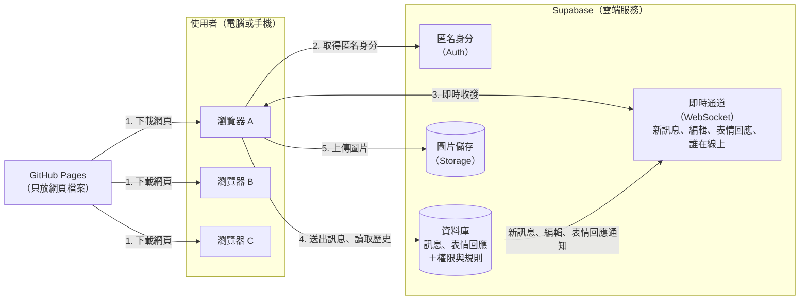

# 匿名聊天室：架構文件

> 這份文件寫給「不寫程式的人」。第一次出現的專有名詞，後面會用一句話解釋。

---

## 1. 專案說明與目標

**這是什麼**：一個不用註冊、不用登入的匿名聊天室。所有人都在同一個聊天室裡。任何知道網址的人，用電腦或手機都能進來。

**使用者會怎麼用**
1. 打開網頁
2. 輸入一個代號（只能英文和數字，最多 12 個字）
3. 進入聊天室，看到所有歷史訊息、看到誰在線上，也可以送出文字或圖片連結

**這一版的目標**
- 先做出一個可以在網路上看到的前端畫面（階段一）
- 再接上真正的即時傳訊功能（階段二）
- 整個專案不需要自己架伺服器，也不用付費

**已經決定的使用者體驗**（來自前面的訪談）

| 項目 | 決定 |
|---|---|
| 代號重複 | 擋下來，請對方換一個 |
| 歷史訊息 | 新加入的人看得到全部 |
| 訊息顯示 | 代號、時間；自己的訊息靠右，別人的靠左 |
| 訊息內容 | 純文字，加上圖片連結（會直接顯示成圖片） |
| 送出方式 | 只能按「送出」按鈕，Enter 鍵是換行 |
| 離開提示 | 聊天區出現系統提示；短暫斷線（例如手機切到別的 App）不顯示加入或離開 |
| 重新整理網頁 | 輸入框會預先填好上次的代號，但仍要按一下「進入」 |
| 新訊息捲動 | 在最底部時自動捲到最新；正在往上翻舊訊息時，不強制捲動，改顯示「有新訊息 ↓」按鈕 |
| 線上名單 | 手機上收合成「線上 N 人」，點了展開；電腦上固定顯示在側邊 |
| 外觀 | 預設跟隨使用者裝置的設定，自動切換明亮與深色；使用者也可以手動切換「跟隨裝置／淺色／深色」，只記在自己的瀏覽器 |
| 自訂顏色 | 使用者可以自訂「主色」（自己的訊息泡泡、送出與進入按鈕）；有幾個預設色、一個自選色、可恢復預設；只記在自己的瀏覽器，別人看不到 |
| 斷線 | 頂端顯示「連線中斷，重新連線中…」；連上後自動補上漏掉的訊息；送出失敗的訊息標示「未送出」，點一下可重送 |
| Emoji | 輸入框旁有 Emoji 選單，點一下就插入 |
| @ 提及 | 輸入 `@` 會列出可標記的人；訊息裡的 `@代號` 會高亮，被標記的人看到更醒目的標示，並收到提醒 |
| 新訊息提醒 | 人不在這個分頁時，分頁標題顯示未讀數，例如「(3) 匿名聊天室」；可自選要不要播放提示音、顯示桌面通知 |
| 搜尋 | 可即時過濾目前對話「已載入」的訊息 |
| 表情回應 | 點一下訊息，選一個表情回應，所有人即時看到 |
| 回覆 | 點一下訊息選「回覆」，新訊息上方會引用原訊息；點引用可跳回原訊息 |
| 編輯與刪除 | 只能對**自己**的訊息；編輯後顯示「（已編輯）」；刪除後內容真的被清掉，顯示「此訊息已刪除」 |
| 正在輸入 | 輸入框上方顯示「某某正在輸入…」（公開聊天室） |
| 多聊天室與私訊 | 三個聊天室（大廳、閒聊、科技）；點線上名單或訊息上的代號可傳私訊，只有雙方看得到 |
| 圖片上傳 | 可上傳 JPG、PNG、GIF、WebP 圖片，每張小於 2 MB，顯示在訊息裡 |
| 防刷屏 | 同一個人 10 秒內最多 5 則、1 分鐘內最多 20 則；超過時提示「送得太快了」，訊息標示「未送出」 |
| 敏感字詞 | 伺服器自動把字詞表裡的字換成 `***`，別人看到的是遮蔽後的版本 |

---

## 2. 整體架構圖

三個角色：

- **瀏覽器**：使用者眼前的網頁，負責畫面和操作。
- **GitHub Pages**：GitHub 提供的免費網頁空間，只負責把網頁檔案交給瀏覽器，**不處理任何聊天內容**。
- **Supabase**：一個現成的雲端服務，負責「給每個瀏覽器一個匿名身分」「記住訊息與圖片」「即時把訊息傳給所有人」，以及在伺服器端執行規則（誰能改什麼、發送太快、敏感字詞）。



**怎麼讀這張圖**
1. 使用者打開網址，瀏覽器從 GitHub Pages 下載網頁。
2. 網頁載入後，向 Supabase 要一個**匿名身分**（不用註冊，使用者不會看到任何登入畫面），記在這個瀏覽器裡。
3. 接著和 Supabase 建立一條「即時通道」。**WebSocket** 是一種讓網頁和伺服器保持連線的技術，有新訊息時伺服器能主動推給你，不用一直重新整理。
4. 送出訊息時，訊息寫進 Supabase 的資料庫；**資料庫會先檢查**：是不是本人、有沒有發太快、有沒有敏感字詞。通過後，資料庫通過即時通道通知所有人。歷史訊息也從資料庫讀取。
5. 上傳圖片時，圖片放進 Supabase 的圖片儲存，訊息裡只記圖片的路徑。

沒有設定 Supabase 的金鑰時，網頁會用假資料自己模擬（見第 4 節）。

---

## 3. 技術選擇

### 3.1 前端：Vite + TypeScript，不使用大型框架

- **選了什麼**
  - **TypeScript**：一種寫網頁程式的語言，比一般 JavaScript 多了「資料格式檢查」，能提早抓到錯誤。
  - **Vite**：一個打包工具，把我們寫的程式整理成瀏覽器能直接用的靜態檔案。
  - 不使用 React、Vue 之類的「框架」（幫忙組織大型網頁的工具包）。
- **為什麼**
  - 這個網頁只有兩個狀態：「輸入代號」和「聊天室」，沒有複雜的頁面跳轉，用框架反而增加不必要的複雜度。
  - Vite 輸出的是純靜態檔案，正好符合 GitHub Pages 只能放靜態檔案的限制。
  - 外觀用原生 CSS（網頁樣式語言）就能做到明亮和深色自動切換，不需要額外工具。

### 3.2 訊息的儲存：Supabase 資料庫

- **選了什麼**：Supabase 的資料庫功能（底層是 PostgreSQL，一種常見的資料庫），建一張叫 `messages` 的表存所有訊息。
- **為什麼**：需求要求「新加入的人看得到全部歷史訊息」，所以訊息必須永久保存，不能只存在瀏覽器裡。

### 3.3 即時收新訊息：Supabase Realtime

- **選了什麼**：Supabase 的 **Realtime** 功能。資料庫一多出一則訊息，它就自動通知所有在線的瀏覽器。
- **為什麼**：不需要自己寫「廣播給所有人」的程式，省事也不容易出錯。

### 3.4 誰在線上：資料庫裡的一張表（不用 Supabase Presence）

- **選了什麼**：資料庫裡的 `online_users` 表，**每個瀏覽器分頁一列**，記錄代號、所在聊天室、是否正在輸入、最後在線時間。
- **為什麼不用 Supabase 內建的 Presence（在線狀態）功能**：一開始用的就是它，但實測在這個專案上**很不穩定**：登記自己常常逾時、「channel error: transport failure」反覆出現、不同人看到的名單彼此不一致，還會殘留已經離開的「幽靈」成員。結果是使用者看到「線上 0 人」、沒有進出提示。改用資料庫記錄之後，同樣的功能由我們已經實測很穩的資料庫與即時通知承擔。
- **運作方式**
  - 進入時新增自己那一列。代號重複由資料庫的「不分大小寫的唯一限制」**一次擋下**，不再有「兩人同時搶代號都進得去」的問題。
  - 每 **12 秒**更新一次自己的「最後在線時間」；切換聊天室、開始或停止輸入時也會更新同一列。
  - 關掉分頁時立刻刪掉自己那一列（用瀏覽器允許在關閉時送出的方式）。如果沒送成（斷電、斷網），超過 **45 秒**沒有任何動靜，其他人就把他視為離線。
  - 其他人的列有新增、修改、刪除時，透過即時通知更新畫面；另外每 **30 秒**向資料庫對一次完整名單，補上即時通知漏掉的變動。
  - 資料庫在每次有人進入時，順手清掉超過 45 秒沒動靜的舊列，所以不需要另外的定時清理工作。
- **取捨**：這張表會有定時的寫入（每人每 12 秒一次），免費方案的用量比 Presence 大一些，但對小型聊天室很小。

### 3.5 身分：Supabase 匿名登入

- **選了什麼**：Supabase Auth 的「匿名登入」。網頁一打開，就自動向 Supabase 要一個隨機的匿名身分（一串看不出是誰的編號），**使用者不用註冊、不用輸入任何資料、也看不到任何登入畫面**。這個身分由函式庫記在這個瀏覽器的 `localStorage` 裡。
- **為什麼**：編輯、刪除自己的訊息、私訊只有雙方看得到、限制發送頻率，這幾件事的前提是「資料庫分得出誰是誰」。沒有身分的話，任何人都能改別人的訊息、讀所有人的私訊。匿名登入剛好能在不違反「不註冊、不登入」的前提下，讓資料庫認得「這是同一個瀏覽器」。
- **代價**：換裝置、換瀏覽器、清除瀏覽器資料，就會變成一個新的身分，**以前發的訊息就不能再編輯或刪除**，私訊記錄也看不到了。代號仍然不代表身分（見第 9 節）。

### 3.6 圖片：Supabase Storage

- **選了什麼**：Supabase 的 Storage（檔案儲存）功能，建一個叫 `chat-images` 的「公開」資料夾。
- **為什麼**：圖片不適合塞進資料庫；Storage 能限制檔案大小與格式，並限制「只有登入的匿名身分才能上傳、只能傳到自己的資料夾」。
- 圖片網址是一串隨機字元，沒有人知道就猜不到，但**知道網址的人都看得到**，包括私訊裡的圖片。

### 3.7 防刷屏與字詞遮蔽：放在資料庫裡

- **選了什麼**：在資料庫的 `messages` 表上設「觸發器」（trigger，每次新增或修改資料時自動先執行的一段檢查程式）。
- **為什麼**：前端的檢查可以被繞過（有心人可以不用我們的網頁，直接對資料庫送資料）。放在資料庫裡才擋得住。字詞表放在一張一般使用者讀不到的表裡，所以別人也看不到你擋了哪些字。

### 3.8 沒有選的東西

- **不使用 email 或社群帳號登入**：需求就是不註冊。
- **不自己架伺服器**：Supabase 已經包辦，維護成本最低。
- **不做伺服器端的全文搜尋**：搜尋只過濾已載入的訊息（見第 6 節）。

---

## 4. 兩個階段，以及如何不用重寫

### 4.1 階段一：先做前端，不接 Supabase

**要做到什麼程度**：整個聊天室的畫面和操作都完整可用，只是資料是「假的」，由前端自己模擬：

- 輸入代號、檢查格式、擋掉「重複代號」（用假的在線名單測試）
- 進入聊天室後，看到一批假的歷史訊息
- 自己送出的訊息會出現在畫面上（靠右），並模擬「傳送中、已送出、未送出可重送」三種狀態
- 模擬其他人定時發言、加入、離開，用來測試提示和線上名單
- 模擬「連線中斷、重新連線」的畫面
- 往上滑載入更多舊訊息、「有新訊息 ↓」按鈕
- 手機與電腦版面、明亮與深色模式

**怎麼在 GitHub Pages 上看到**：把前端建置後的檔案發佈到 GitHub Pages（做法見第 12 節）。完成後，任何人打開網址都能操作這個「示範版」。

**限制**：因為資料是假的，兩個人同時打開網頁看不到彼此，訊息只存在自己的畫面上。

### 4.2 階段二：接上 Supabase

階段二只改變「資料從哪裡來」：

| 項目 | 階段一 | 階段二 |
|---|---|---|
| 身分 | 瀏覽器分頁自己的隨機編號 | Supabase 匿名登入，記在瀏覽器裡 |
| 歷史訊息 | 假資料 | Supabase 資料庫 |
| 送出訊息 | 只出現在自己畫面 | 寫進資料庫，所有人都收到 |
| 誰在線上 | 模擬 | 資料庫的 `online_users` 表 |
| 代號重複 | 對照假名單 | 對照真正的在線名單 |
| 斷線 | 手動模擬 | 真正偵測網路狀態 |

**延伸功能在兩個階段的支援程度**

| 功能 | 階段一（模擬資料） | 階段二（Supabase） |
|---|---|---|
| 多聊天室、回覆、表情回應、編輯與刪除自己的訊息 | 有（假的，只在自己畫面上） | 有（真的） |
| 私訊、圖片上傳、「正在輸入」 | **沒有**，畫面上會自動隱藏這些按鈕 | 有 |
| 防刷屏、敏感字詞遮蔽 | 沒有 | 有（資料庫端） |
| 搜尋、Emoji、@ 提及、分頁標題未讀數、提示音、桌面通知、手動切換深淺色 | 有（純前端） | 有（純前端） |

畫面如何知道資料來源支援什麼：資料來源會回報一份「支援的功能」清單（`features`），畫面據此顯示或隱藏按鈕。

### 4.3 如何避免整個重寫

做法是在「畫面」和「資料來源」中間放一道**固定的介面**（可以想成插座規格）：

- 畫面部分的程式，只透過這個介面問問題：「給我歷史訊息」「我要送這則訊息」「現在誰在線上」，並接收「有新訊息」「有人加入」之類的通知。畫面**完全不知道**資料是真的還是假的。
- 階段一，介面後面接「模擬資料來源」。
- 階段二，換成「Supabase 資料來源」。兩者遵守同一份規格（第 5 節），所以畫面程式不用改。

---

## 5. 通訊約定

畫面和資料來源之間用「事件」溝通。事件就是「發生了某件事」的通知，每種事件有固定名稱和資料格式。

### 5.1 資料來源會通知畫面的事件

| 事件名稱 | 什麼時候發生 | 帶的資料 |
|---|---|---|
| `message:new` | 有一則新訊息（別人的，或自己送出成功確認） | 一則訊息 |
| `message:update` | 一則訊息被編輯或刪除 | 更新後的訊息 |
| `reaction:add` | 有人對某則訊息加了表情 | 訊息編號、表情、是誰 |
| `reaction:remove` | 有人拿掉了表情 | 訊息編號、表情、是誰 |
| `presence:sync` | 取得或更新完整的在線名單（包含每個人在哪個聊天室、是否正在輸入） | 在線者清單 |
| `presence:join` | 有人加入 | 一位在線者 |
| `presence:leave` | 有人離開 | 一位在線者 |
| `connection:status` | 連線狀態改變 | 狀態：`connected`（已連線）、`reconnecting`（重連中）、`offline`（離線） |

「在線者換聊天室」或「開始、停止輸入」只會觸發 `presence:sync`，不會被當成加入或離開。

### 5.2 畫面可以對資料來源下的指令

| 指令名稱 | 做什麼 | 回傳 |
|---|---|---|
| `join` | 取得匿名身分並用代號進入 | 成功，或失敗原因（代號格式錯誤、代號已被使用、無法建立匿名身分、連線失敗） |
| `leave` | 離開 | 無 |
| `setPresence` | 更新自己在線的資訊：現在在哪個聊天室、是否正在輸入 | 無 |
| `loadRooms` | 取得聊天室清單 | 聊天室清單 |
| `loadDmPeers` | 取得以前私訊過的對象 | 對象清單 |
| `loadLatest` | 取得某個對話最新 50 則歷史訊息 | 訊息清單，並告知是否還有更舊的 |
| `loadOlder` | 取得比目前最舊的那則更早的 50 則 | 訊息清單，並告知是否還有更舊的 |
| `loadAfter` | 斷線重連後，取得某個編號之後新增或被修改的訊息（第 6.4 節的「補訊息」） | 訊息清單 |
| `loadReactions` | 查一批訊息目前有哪些表情回應 | 每則訊息的表情清單 |
| `send` | 送出一則訊息（可帶回覆對象、圖片、私訊對象） | 成功，或失敗原因（離線、內容不合規定、送太快、其他錯誤） |
| `edit` | 編輯自己的訊息 | 更新後的訊息，或失敗原因 |
| `remove` | 刪除自己的訊息 | 更新後的訊息，或失敗原因 |
| `react` | 對訊息加上或拿掉一個表情 | 成功，或失敗原因 |
| `uploadImage` | 上傳一張圖片 | 圖片路徑，或失敗原因（格式不對、太大、其他錯誤） |

### 5.3 資料格式

**一則訊息**

| 欄位 | 意思 | 範例 |
|---|---|---|
| `id` | 資料庫給的流水號，數字越大越新；傳送中尚未取得時為空 | `1024` |
| `clientMsgId` | 前端為每則訊息隨機產生的唯一編號，用來在重送時避免變成兩則 | `"b7e2…"`（一串隨機字元） |
| `conversation` | 這則訊息屬於哪個對話（見下方「對話編號」） | `"room:lobby"` |
| `userId` | 作者的匿名身分編號；用它判斷「這是不是我的訊息」。舊訊息沒有作者時為空 | `"3f1c…"` |
| `nickname` | 發送者代號 | `"Amy01"` |
| `toNickname` | 私訊的收件人代號（公開訊息為空） | `"Ben"` |
| `body` | 訊息文字（已經過敏感字詞遮蔽；刪除後是「[已刪除]」） | `"大家好"` |
| `createdAt` | 發送時間，由資料庫決定（不採用使用者裝置的時間，避免被亂改） | `2026-10-13 14:32` |
| `editedAt` | 最後編輯時間，沒編輯過為空 | |
| `deletedAt` | 刪除時間，沒刪除為空 | |
| `replyTo` | 回覆的對象：原訊息編號、原作者代號、內容摘要（前 80 字）。**摘要由資料庫從原訊息抄過來**，使用者不能偽造別人說過的話 | |
| `imagePath` | 上傳的圖片在 Storage 裡的路徑，沒有圖片為空 | |
| `reactions` | 表情回應清單，每筆是「哪個表情、誰按的」 | `[{"emoji":"👍","userId":"…"}]` |
| `sendState` | 只存在前端：`sending` 傳送中、`sent` 已送出、`failed` 未送出 | `"sent"` |

**對話編號**：公開聊天室是 `room:` 加聊天室代碼（例如 `room:lobby`）；私訊是 `dm:` 加對方的匿名身分編號。

**聊天室**：`id`（代碼，例如 `lobby`）和 `name`（顯示名稱，例如「大廳」）。清單存在資料庫的 `rooms` 表，要新增聊天室，到 Supabase 的 Table Editor 在 `rooms` 表加一列即可（程式不用改）。

**一位在線者**

| 欄位 | 意思 |
|---|---|
| `nickname` | 代號 |
| `clientId` | 每個瀏覽器分頁自己產生的隨機編號，用來辨識「這是同一個人短暫斷線後回來」。**它不是身分，也不會被存起來**。 |
| `userId` | 匿名身分編號，私訊用它指定對象 |
| `joinedAt` | 進入時間 |
| `room` | 現在待在哪個公開聊天室 |
| `typing` | 是否正在輸入 |

**系統提示**（只在畫面上顯示，不存進資料庫）

| 欄位 | 意思 |
|---|---|
| `type` | `join`（加入）或 `leave`（離開） |
| `nickname` | 是誰 |

系統提示在畫面上只顯示文字，不顯示時間。

---

## 6. 資料流：各種情境發生什麼事

### 6.1 進入聊天室

1. 使用者打開網頁，輸入框預先填好上次用過的代號（瀏覽器自己記的，沒有就留空）。
2. 按「進入」。前端先檢查格式：只能英文和數字、1 到 12 個字。不合格就在輸入框下方提示。
3. 前端查看目前在線名單。代號**不分大小寫**，例如 `Amy01` 和 `amy01` 視為同一個。如果代號已有人使用，提示「這個代號有人用了，請換一個」，停留在輸入畫面。
4. 通過的話，先取得（或沿用）這個瀏覽器的匿名身分，記住代號供下次預填，登記為在線者，載入聊天室清單、私訊對象，以及第一個聊天室最新 50 則歷史訊息，顯示聊天室。
5. 你自己的聊天區底部會出現一行歡迎提示「你已進入聊天室，目前有 N 人在線上」（N 含你自己）；其他人的畫面會收到「某某加入了聊天室」。你進入之前就已經在線上的人，不會補發加入提示。

> **代號重複由資料庫一次擋下**：登記為在線者時，資料庫用「不分大小寫的唯一限制」判斷。兩個人即使在同一瞬間按「進入」，也只有一個人會成功，另一個直接得到「這個代號有人用了」，不會有兩人都進得去的情況。例外：同一個人重新整理網頁時，上一個分頁那一列如果還在（約 20 秒內沒更新才算舊的），會暫時顯示「有人用了」，等幾秒再按「進入」即可。

### 6.2 送出訊息

1. 使用者按「送出」按鈕（Enter 只是換行）。內容是空的，或超過上限時，按鈕不能按。
2. 訊息立刻出現在自己畫面上，標示「傳送中」。
3. 訊息寫進資料庫。資料庫會先檢查本人身分、發送頻率，並把敏感字詞換成 `***`。成功後，系統收到新訊息通知（內容是遮蔽後的版本），標示變成「已送出」。
4. 如果失敗（例如網路斷了，或發送太快被資料庫擋下）：標示「未送出」並顯示原因，使用者點一下就重送。重送使用同一個 `clientMsgId`，所以就算第一次其實已成功，也不會出現兩則。
5. 其他人在畫面上看到這則訊息；如果對方停在底部就自動捲到最新，如果對方正在翻舊訊息，則出現「有新訊息 ↓」按鈕。自己送出的訊息，自己永遠會捲到最底。

### 6.3 離開

1. 使用者關掉網頁，或網路斷掉太久。
2. 關掉分頁時，瀏覽器會立刻送出「刪除我那一列」，其他人的線上名單**馬上**移除他。如果沒送成（斷網、當機），超過 45 秒沒有動靜，其他人的畫面也會把他移除。
3. 聊天區的「某某離開了聊天室」提示會**等約 10 秒**再出現。如果這 10 秒內同一個人回來了（例如手機切到別的 App 又切回來），就不顯示任何離開或加入的提示。
4. 這樣避免手機使用者頻繁切換時，聊天區被「離開、加入、離開、加入」洗版。

### 6.4 斷線與重新連線

1. 網路中斷時，畫面頂端出現「連線中斷，重新連線中…」。已經在畫面上的訊息保持不動。
2. 這段期間如果訊息送不出去（網路確實斷了，或寫入失敗），就標示「未送出」，使用者可以點一下重送。如果只是即時通道在重連、網路其實是通的，訊息會直接送出成功。
3. 網路恢復後，系統自動重新連線，提示消失。
4. 然後自動補上斷線期間漏掉的訊息（每個已載入的對話，向資料庫要「最近 50 則之後」新增或被修改的訊息，並重新查一次這些訊息的表情回應），並重新登記為在線者。
5. 手機從背景切回前景，視同一次斷線再重連，走同一個流程。

### 6.5 編輯與刪除

1. 使用者點一下**自己的**訊息，下方出現操作列，選「編輯」或「刪除」。別人的訊息沒有這兩個選項。
2. **編輯**：訊息內容放回輸入框，輸入區上方顯示「編輯訊息」，按鈕變成「儲存」。儲存後所有人的畫面即時更新，訊息顯示「（已編輯）」。內容一樣不會送出。
3. **刪除**：第一次按變成「再按一次確認」，3 秒內再按一次才會刪除。刪除後訊息內容在資料庫裡**真的被清掉**，所有人看到「此訊息已刪除」。
4. 這兩件事由資料庫把關：只有訊息的作者（匿名身分相同）改得動，而且只能改內容或標記刪除，其他欄位一律不能動；已刪除的訊息不能再改。

### 6.6 表情回應

1. 點一下訊息，操作列有三個快速表情（👍 ❤️ 😂）和「＋」（打開完整選單）。
2. 選一個表情，畫面立刻出現，同時寫進資料庫；其他人透過即時通道看到。再按一次同樣的表情就是收回。
3. 訊息下方顯示每個表情和人數，自己按過的有選取標記。失敗時會還原並顯示提示。
4. 同一個人對同一則訊息最多 6 種表情；已刪除的訊息不能加表情。

### 6.7 回覆

1. 點一下訊息，選「回覆」，輸入區上方顯示「回覆 某某：內容摘要」，可按 ✕ 取消。
2. 送出後，新訊息上方出現引用區塊（原作者與摘要）。引用內容由資料庫從原訊息抄過來。
3. 點引用區塊，畫面捲到原訊息並短暫標示；如果原訊息還沒載入，顯示提示請往上捲動載入更多。

### 6.8 聊天室與私訊

1. **聊天室**：側邊欄（手機是點頂部的「線上 N 人」展開）列出所有聊天室，顯示各自的在線人數與未讀數。點一下切換；第一次進入才載入歷史訊息。切換時，自己的「所在聊天室」同步更新，線上名單看的是目前這間。
2. **私訊**：點線上名單裡的代號，或訊息上別人的代號，開啟和對方的私訊。私訊對象會列在側邊欄的「私訊」區。
3. 私訊**只有寄件人和收件人讀得到**，由資料庫的讀取規則把關，連即時通知也只會送給這兩個人。
4. 收到私訊時，如果當時不在那個對話，側邊欄對應項目顯示未讀數，並依設定播放提示音與顯示桌面通知。
5. 私訊裡沒有「正在輸入」提示，也沒有 @ 提及清單以外的對象。
6. 對方關掉分頁後仍然可以傳私訊，對方下次上線（同一個瀏覽器）時會看到；但如果對方換了裝置或清除瀏覽器資料，他就是新身分，收不到以前的私訊。

### 6.9 正在輸入

1. 使用者在公開聊天室的輸入框打字時，自己那一列標記為「正在輸入」；停止打字約 3 秒、送出、離開輸入框或切換對話時取消。
2. 其他人的輸入框上方顯示「某某正在輸入…」（兩人以內列出名字，更多人顯示人數），側邊欄線上名單的對方旁也會標「輸入中」。
3. 只在同一個聊天室內顯示；私訊不顯示。

### 6.10 圖片上傳

1. 使用者按輸入框旁的圖片按鈕，選一張圖片。前端先檢查格式（JPG、PNG、GIF、WebP）和大小（小於 2 MB），不符合就顯示提示，不上傳。
2. 通過後上傳到 Storage（只能傳到自己的資料夾），輸入區上方出現縮圖與「圖片已準備好，按送出發出」，可按 ✕ 移除。
3. 按「送出」後，訊息帶著圖片路徑一起寫進資料庫，所有人看到圖片（可點開原圖）。圖片可以搭配文字，也可以不寫字。
4. 已知限制：選了圖片但沒有送出，檔案仍會留在 Storage 裡（沒有自動清理）；刪除訊息也不會刪掉檔案，只是訊息不再顯示它。

### 6.11 防刷屏與敏感字詞

1. **防刷屏**：資料庫檢查同一個匿名身分，10 秒內超過 5 則、或 1 分鐘內超過 20 則，就拒收這則訊息。畫面顯示「送得太快了，請稍等幾秒再試」，訊息標示「未送出」，稍後可點重送。
2. **敏感字詞**：資料庫把訊息（包含編輯後的內容）裡出現在字詞表的字，換成同樣長度的 `*`（不分大小寫）。所以包含自己在內，所有人看到的都是遮蔽後的版本。
3. 字詞表是資料庫裡的 `blocked_words` 表，只有專案擁有者能在 Supabase 後台增減；一般使用者讀不到。預設只放了幾個範例，請依需求自行調整。
4. 字詞遮蔽是單純的「包含就換」，可能誤傷（例如英文單字的一部分）；也擋不住刻意用符號、空格、諧音拆開的寫法。

### 6.12 新訊息提醒：分頁標題、提示音、桌面通知

1. **分頁標題**：使用者不在這個分頁（切到別的分頁、視窗縮小、視窗沒有焦點）時，每收到一則別人的新訊息，分頁標題的未讀數加一，例如「(3) 匿名聊天室」。回到這個分頁就歸零。
2. **提示音**：在「外觀與通知」設定裡可開關（預設開）。以下情況才響：人不在這個分頁、新訊息在別的對話、新訊息是私訊、或訊息標記了自己。正在看的聊天室裡的一般訊息不響，避免吵人。聲音由瀏覽器即時產生，沒有音檔。
3. **桌面通知**：預設關閉。使用者在設定裡打開時，瀏覽器會詢問是否允許通知；允許後，人不在這個分頁時，新訊息會彈出桌面通知（顯示代號、對話與內容前 120 字），點通知會回到網頁並切到那個對話。如果使用者在瀏覽器拒絕，設定會還原並說明怎麼改。有些手機瀏覽器不支援網頁通知。
4. 這些設定都只記在這個瀏覽器。

### 6.13 搜尋

1. 按頂部的放大鏡開啟搜尋列，輸入關鍵字，目前對話裡**已載入**的訊息即時被過濾，只剩代號或內容含有關鍵字的（不分大小寫），並顯示「找到幾則」。
2. 因為只搜尋已經載入的訊息，如果還有更早的訊息沒載入，會出現「載入更早的訊息再找」按鈕。
3. 關閉搜尋列或切換對話，就恢復完整顯示。

### 6.14 @ 提及

1. 在輸入框打 `@`，會列出目前可以標記的人（同一個聊天室的在線者；私訊則是對方），隨輸入縮小範圍。點選項目，或按 Tab 選第一個，就會插入「@代號 」。
2. 訊息裡的 `@代號` 會用醒目的底色標示；如果標的是自己，標示更明顯，整則訊息的泡泡也會加上外框。
3. 被標記的人，即使正在看那個聊天室，也會播放提示音（如果有開）。
4. 標記只是文字約定，沒有權限意義；標記不存在或已離線的代號也可以。

---

## 7. 畫面清單

這一節只寫「有什麼元素、各自做什麼」。顏色、字體、間距、動畫由 `/design` 負責。

### 7.1 畫面一：進入畫面

| 元素 | 行為 |
|---|---|
| 標題與簡短說明 | 說明這是匿名聊天室 |
| 代號輸入框 | 預先填好上次的代號；限制英文和數字、最多 12 字；輸入不合規定的字元時給提示 |
| 「進入」按鈕 | 按下後檢查代號；格式不對或已被使用時，不進入，並顯示原因；檢查期間按鈕顯示處理中，防止連按 |
| 錯誤提示 | 顯示在輸入框附近，說明「格式不對」或「這個代號有人用了，請換一個」 |

### 7.1.1 兩個畫面共用：外觀與通知設定

| 元素 | 行為 |
|---|---|
| 設定按鈕 | 進入畫面固定在右上角，聊天室畫面在頂部列；按一下開關面板，按 Esc 或點面板外也會關閉 |
| 深淺色 | 三選一：跟隨裝置、淺色、深色；選了立刻套用 |
| 預設主色 | 六個預設色，目前使用的有選取標記；選了立刻套用 |
| 自選顏色 | 用瀏覽器內建的取色器挑任何顏色，立刻套用；系統會自動決定主色上的文字用白色或深色，確保看得清楚 |
| 主色恢復預設 | 回到原本的青綠色 |
| 提示音（只在聊天室） | 開關 |
| 桌面通知（只在聊天室） | 開關；打開時會請瀏覽器詢問是否允許 |
| 記憶 | 所有選擇存在這個瀏覽器的 `localStorage`，下次打開網頁自動套用；換裝置或清除瀏覽器資料就回到預設。不會傳給別人，也不碰 Supabase |

### 7.2 畫面二：聊天室

**頂部列**

| 元素 | 行為 |
|---|---|
| 對話名稱 | 公開聊天室顯示「# 大廳」，私訊顯示「私訊 某某」 |
| 你的代號 | 只在電腦版顯示 |
| 搜尋按鈕 | 開關搜尋列（見下方） |
| 設定按鈕 | 見 7.1.1 |
| 「線上 N 人」 | 只在手機版出現：點一下展開或收合側邊欄；其他對話有未讀時，按鈕角落顯示小紅點。N 是目前聊天室的在線人數 |
| 連線狀態提示 | 連線中斷時顯示「連線中斷，重新連線中…」，恢復後自動消失 |

**搜尋列**（按搜尋按鈕才出現）

| 元素 | 行為 |
|---|---|
| 搜尋輸入框 | 輸入時即時過濾目前對話已載入的訊息 |
| 結果說明 | 顯示「在已載入的訊息中找到 N 則」 |
| 載入更早的訊息再找 | 還有更早的訊息沒載入時才出現 |
| 關閉按鈕 | 關閉搜尋並恢復完整顯示 |

**側邊欄**（電腦版固定在左側；手機版是點「線上 N 人」展開的浮層，點旁邊或選了項目就收起）

| 區塊 | 行為 |
|---|---|
| 聊天室 | 列出所有聊天室，顯示各自的在線人數與未讀數；目前所在的有標記；點一下切換 |
| 私訊 | 列出私訊過的對象與未讀數，點一下開啟；還沒有時提示「點線上名單裡的代號，就能傳私訊」。資料來源不支援私訊時（階段一）整區隱藏 |
| 線上名單 | 標題顯示「線上 N 人（聊天室名稱）」；自己排第一並標「你」；別人的代號是按鈕，點一下開啟私訊；正在輸入的人旁邊標「輸入中」 |

**訊息區**

| 元素 | 行為 |
|---|---|
| 訊息泡泡 | 別人的靠左、自己的靠右（以匿名身分判斷）；每則顯示代號與時間（例如 14:32），編輯過的加註「（已編輯）」；別人的代號可以點，開啟私訊 |
| @ 提及 | 訊息裡的 `@代號` 高亮；標到自己時更醒目，整個泡泡加外框 |
| 引用 | 回覆的訊息上方顯示「原作者：摘要」，點一下跳到原訊息 |
| 圖片 | 有大小上限；點圖片開啟原圖；載入失敗時退回顯示網址文字 |
| 已刪除的訊息 | 顯示斜體的「此訊息已刪除」，沒有任何操作 |
| 表情回應 | 泡泡下方顯示每個表情和人數，自己按過的有選取標記，點一下加上或收回 |
| 操作列 | 點一下訊息才出現（再點一下收起）：三個快速表情、「＋」更多表情、「回覆」；自己的訊息另有「編輯」和「刪除」（刪除要按兩次確認）。傳送中、未送出、已刪除的訊息沒有操作列 |
| 傳送狀態 | 自己的訊息顯示「傳送中」；失敗時顯示「未送出，點一下重送」 |
| 系統提示 | 置中顯示「某某加入了聊天室」「某某離開了聊天室」，外觀與一般訊息明顯不同 |
| 往上捲載入舊訊息 | 捲到頂端時自動載入更早的 50 則，畫面位置不會跳走；沒有更舊的訊息時顯示「已經是最早的訊息」；第一次進入某個對話時顯示「載入中…」 |
| 「有新訊息 ↓」按鈕 | 只在使用者正往上翻舊訊息、而又有新訊息進來時出現；點了跳到最新並消失 |
| 自動捲動 | 使用者停在最底部時，新訊息進來自動捲到最新 |
| 提示（toast） | 操作失敗時短暫顯示原因，例如「送得太快了」 |

**Emoji 選單**：按輸入框旁的笑臉按鈕，或操作列的「＋」打開；分成表情、手勢、愛心與符號、動物與食物四組；點一個就插入輸入框（或加成表情回應）並關閉；點選單外面關閉。

**輸入區**

| 元素 | 行為 |
|---|---|
| 「正在輸入」提示 | 輸入框上方顯示誰正在輸入（公開聊天室） |
| 回覆、編輯、圖片的提示列 | 顯示正在回覆誰、正在編輯、或圖片上傳中／已準備好，各有 ✕ 可取消 |
| Emoji 按鈕 | 打開 Emoji 選單 |
| 圖片按鈕 | 選圖片上傳；編輯訊息時隱藏；資料來源不支援時（階段一）隱藏 |
| 多行文字框 | Enter 換行，不會送出；輸入 `@` 會跳出可標記的人（Tab 選第一個，Esc 關閉）；有字數上限，接近上限時顯示剩餘字數 |
| 「送出」按鈕 | 內容空白（也沒有圖片）或超過上限時不能按；編輯時變成「儲存」；按下後清空文字框並顯示「傳送中」 |

---

## 8. 金鑰

**金鑰**是一段文字，像鑰匙一樣，讓你的網頁有權限跟 Supabase 溝通。

### 8.1 這個專案會用到什麼

| 名稱 | 用途 | 能不能公開 |
|---|---|---|
| **專案網址（Project URL）** | 告訴網頁 Supabase 在哪裡 | 可以公開 |
| **anon key（也叫 publishable key，公開金鑰）** | 讓網頁以「一般訪客」身分讀取與寫入訊息 | **可以公開**，設計上就會出現在網頁裡 |
| **service_role key（管理金鑰）** | 擁有 Supabase 專案的完全控制權，可以繞過所有保護 | **絕對不能公開**，這個專案**完全用不到**，也不應該拿到前端或放進 repo |
| **資料庫密碼** | 建立專案時設定，用於直接連線資料庫 | **絕對不能公開**，這個專案的網頁不會用到 |
| **匿名身分的憑證** | 匿名登入後，函式庫自動產生並存在使用者自己瀏覽器裡，用來證明「我是我」 | 每個人只有自己的；**不用你管理，也不會出現在 repo 裡**。這一版**沒有新增任何要你保管的金鑰** |

### 8.2 怎麼產生

1. 到 Supabase 網站註冊並建立一個專案；建立時會要你設定資料庫密碼，把它存在你自己的密碼管理工具裡。
2. 專案建好後，在專案設定的 API 頁面可以看到「Project URL」和「anon key」，複製這兩個。
3. 同一頁面也會看到 `service_role key`，**不要複製、不要貼到任何地方**。

### 8.3 放在哪裡

| 情境 | 放哪裡 |
|---|---|
| 自己的電腦開發時 | 專案資料夾裡一個叫 `.env.local` 的檔案（見下方防 commit） |
| 部署到 GitHub Pages 時 | GitHub 專案設定裡的 Actions Variables（讓自動部署流程在建置網頁時帶入這兩個值） |

### 8.4 為什麼公開金鑰可以公開

網頁的程式會被下載到每位使用者的瀏覽器，**任何人都能看到網頁裡的內容**，所以放在前端的東西本來就藏不住。真正的保護來自 Supabase 資料庫的規則（RLS，第 9 節）：就算別人拿到 anon key，也只能做規則允許的事：讀公開訊息；匿名登入之後，新增訊息、只能改刪自己的訊息、讀自己的私訊。

### 8.5 怎麼避免被 commit 到 GitHub

- **commit** 是把檔案存進 git 版本紀錄並可推送到 GitHub 的動作；一旦推上去，即使之後刪除，歷史紀錄裡仍找得到。
- 做法：
  1. 在 `.gitignore`（告訴 git「這些檔案不要追蹤」的清單）加入 `.env.local`，讓它永遠不會被 commit。
  2. 在 repo 提供一個 `.env.example`，只寫變數名稱和假的範例值，讓別人知道要填什麼。
  3. 每次 commit 前用 `git status` 檢查要提交的檔案清單。
- 萬一誤傳了 `service_role key` 或資料庫密碼：立刻到 Supabase 重新產生（讓舊的失效），不要只是刪掉檔案。

---

## 9. 安全與限制

### 9.1 別人可能送什麼奇怪的東西，前端怎麼擋

> 前端的檢查是為了使用體驗；真正的把關在資料庫端（見 9.2），因為有心人可以繞過網頁直接送資料。

| 可能的狀況 | 前端怎麼處理 |
|---|---|
| 訊息裡夾帶網頁程式碼（例如 `<script>…</script>`），企圖在別人的瀏覽器執行 | 所有訊息和代號一律當成**純文字**顯示，絕不當成網頁語法解讀，所以不會被執行。@ 提及的高亮也是用文字節點組出來的，不是拼網頁語法 |
| 圖片連結指向惡意網址或非圖片 | 只有 `https://` 開頭、並以 `.jpg`、`.jpeg`、`.png`、`.gif`、`.webp` 結尾的網址才會顯示成圖片，其他都只當文字顯示 |
| 圖片主機追蹤觀看者 | 載入圖片時不帶出自己的來源網址資訊；圖片延遲載入。但「圖片主機看得到你的 IP」是顯示外部圖片本身無法避免的代價 |
| 上傳奇怪的檔案（網頁、程式、超大檔案） | 前端先擋格式與大小；資料庫儲存端也只收 JPG、PNG、GIF、WebP，且每個檔案不超過 2 MB。不收 SVG，因為 SVG 可以夾帶程式 |
| 超長訊息、一大堆空白 | 限制長度上限 2000 字；全是空白（也沒有圖片）的訊息不允許送出 |
| 代號亂填（符號、表情符號、超長） | 只接受英文和數字、最多 12 字 |
| 冒用別人的代號 | 同一時間在線者代號不能重複（不分大小寫）；但對方離線後，別人就可以用他的代號，所以**代號不能代表身分**。畫面判斷「這是不是我的訊息」改用匿名身分，不是代號，所以接手同一個代號的人**不會**把以前的訊息看成自己的 |
| 偽造引用（假裝某人說過某句話） | 引用的作者與摘要由資料庫從原訊息抄過來，前端送的不算 |
| 亂用表情當作傳訊息的管道 | 資料庫限制表情只能是短短的非英數字符號，每人每則訊息最多 6 種 |
| 連續洗版 | 資料庫限制 10 秒 5 則、1 分鐘 20 則；超過就拒收 |
| 敏感字詞 | 資料庫自動遮蔽（見 6.11） |

### 9.2 資料庫端的保護

- 用 **RLS（Row Level Security，資料列安全規則）**，規則依「匿名身分」判斷：
  - **訊息**：公開訊息所有人讀得到；私訊只有寄件人和收件人讀得到。只有匿名登入的使用者能新增，而且作者一定是自己（填不出別人的身分）。只能改自己的訊息，且只能改內容或標記刪除。**沒有任何人能真的刪除一列**，「刪除」是把內容清成「[已刪除]」並標記時間。
  - **表情回應**：只能新增、收回「自己的」；只能對看得到、且沒被刪除的訊息加。
  - **聊天室清單**：所有人只讀。
  - **字詞表**：一般使用者完全碰不到。
  - **圖片**：只有匿名登入的使用者能上傳，而且只能傳到「自己的身分編號」命名的資料夾；不能覆蓋、修改、刪除。
- 使用者新增訊息時，能填的欄位只有「內容、聊天室或收件人、回覆對象、圖片」；編號、時間、作者、引用內容都由資料庫決定。
- 資料庫對代號格式、訊息長度、圖片路徑格式也設規則，不符合直接拒收，就算有人繞過網頁也一樣。

### 9.3 免費方案的上限（需注意）

> 以下是類型與大致說明；**具體數字請以各服務官方的最新定價頁為準**，會調整。

| 服務 | 要注意的限制 |
|---|---|
| **Supabase 免費方案** | ① 資料庫儲存空間有上限，歷史訊息會永久累積，聊太久可能滿。② 同時在線的即時連線人數有上限。③ 每秒可傳的即時訊息數量有上限（現在多了編輯、表情回應、「正在輸入」，用量比以前大）。④ **專案閒置一段時間（目前約一週沒有使用）會被自動暫停**，暫停期間聊天室無法使用，需要到後台手動恢復。⑤ 免費方案通常沒有自動備份保證。⑥ **圖片儲存空間有上限**，圖片很快會比文字占更多空間。⑦ **匿名登入有頻率限制**（同一個網路位址每小時能建立的匿名身分有限），很多人從同一個網路（例如學校、公司）同時第一次進來時，可能有人暫時進不來。 |
| **GitHub Pages** | 網站大小與每月流量有額度；免費方案要求 repo 是公開的（程式碼別人看得到，所以前面強調不能放私密金鑰）。 |

這是小型聊天室，通常不會碰到上限，但要知道「一週沒人用會被暫停」這件事。

### 9.4 已知限制與取捨

- **匿名登入有次數限制**：同一個網路位址短時間內建立太多匿名身分，會顯示「短時間內嘗試進入的次數太多」。開發、測試時特別容易碰到；可以到 Supabase 的 Authentication → Rate Limits 調高「Anonymous sign-ins」的上限。

- **身分綁在瀏覽器**：換裝置、換瀏覽器、清除瀏覽器資料，就是新的身分。以前的訊息不能再編輯或刪除，私訊也看不到。
- **私訊不是端對端加密**：它對「其他使用者」是私密的，但 Supabase 的專案擁有者在後台看得到全部資料。
- **圖片網址知道就看得到**：包含私訊裡的圖片。
- **上傳後沒送出的圖片不會自動清理**，刪除訊息也不會刪檔案。
- **防刷屏綁匿名身分**：有心人可以反覆清除瀏覽器資料換新身分繞過。這一版沒有更強的防護（例如依網路位址限制、驗證碼）。
- **字詞過濾很簡單**：只做「包含就換」，擋不住諧音或拆字。
- **搜尋只搜已載入的訊息**。
- **刪除表情回應的即時通知**：這類通知無法依權限過濾，其他人的瀏覽器會收到「某人拿掉了某表情」，內容只有訊息編號、表情與匿名身分編號，沒有訊息內容。

---

## 10. 這一版刻意不做的事

| 不做的事 | 原因 |
|---|---|
| email、社群帳號登入、註冊 | 需求明確是匿名、不登入；匿名身分已經足夠支撐編輯、刪除與私訊 |
| 保證代號有人專用（代號擁有權） | 代號只在線上期間有效，不綁定匿名身分；要做就得有帳號 |
| 跨裝置同步身分 | 匿名身分只存在瀏覽器；要做就得有帳號 |
| 管理員功能、封鎖使用者、檢舉 | 需求沒提到。真有需要，由專案擁有者到 Supabase 後台手動處理（刪訊息、改字詞表、停用某個匿名使用者） |
| 更強的洗版防護（驗證碼、依網路位址限制） | 先用匿名身分的頻率限制；若實際出現濫用再補 |
| 使用者自建聊天室 | 聊天室清單由專案擁有者在後台維護，避免被濫用 |
| 清理沒用到的圖片 | 需要定期工作；先接受浪費一點空間 |
| 在伺服器端搜尋全部歷史訊息 | 目前只過濾已載入的訊息 |
| 訊息格式（粗體、連結預覽） | 非必要功能，先維持純文字加圖片 |
| 已讀回條 | 非必要功能 |
| 私訊的「正在輸入」 | 只做公開聊天室 |
| 瀏覽器關閉後仍能收到的推播 | 需要額外的伺服器與服務；現在的桌面通知只在網頁開著（含背景分頁）時有效 |
| 多語系 | 這一版只做中文介面 |

---

## 11. repo 的資料夾結構

**repo**（repository，專案倉庫）就是放這個專案所有檔案的資料夾，會同步到 GitHub。

```
ch3/
├─ docs/                        文件
│   ├─ requirements.md            需求說明
│   └─ architecture.md            本文件
│
├─ src/                         網頁的程式碼
│   ├─ main.ts                    程式進入點，決定顯示進入畫面還是聊天室
│   ├─ config.ts                  讀取專案網址與公開金鑰的設定
│   ├─ theme.ts                   自訂主色：套用顏色、記在瀏覽器裡
│   ├─ prefs.ts                   個人偏好：深淺色模式、提示音、桌面通知（記在瀏覽器裡）
│   ├─ notifier.ts                新訊息提醒：分頁標題未讀數、提示音、桌面通知
│   ├─ chat/                      「資料來源」與畫面狀態
│   │   ├─ types.ts                 介面規格：事件名稱與資料格式（第 5 節）
│   │   ├─ rules.ts                 代號、訊息長度、對話編號、@ 提及的規則
│   │   ├─ store.ts                 畫面狀態：多個對話的訊息、線上名單、連線狀態、未讀數、離開提示的緩衝
│   │   ├─ mock.ts                  模擬資料來源，沒設定金鑰時使用的假資料
│   │   ├─ supabase.ts              Supabase 資料來源，階段二使用的真資料
│   │   └─ index.ts                 選擇用哪個資料來源的唯一入口（沒設定金鑰就用模擬資料）
│   ├─ ui/                        畫面
│   │   ├─ entry.ts                 進入畫面
│   │   ├─ chat.ts                  聊天室畫面：頂部列、搜尋、訊息列表、組合其他元件
│   │   ├─ sidebar.ts               側邊欄：聊天室、私訊、線上名單
│   │   ├─ message.ts               一則訊息：泡泡、引用、圖片、@ 高亮、表情回應、操作列
│   │   ├─ composer.ts              輸入區：Emoji、圖片、回覆與編輯、@ 提示、正在輸入
│   │   ├─ emoji.ts                 Emoji 選單
│   │   ├─ settings.ts              外觀與通知設定面板
│   │   ├─ dev.ts                   「測試工具」面板，只在使用模擬資料時出現
│   │   ├─ dom.ts                   建立網頁元素的小工具
│   │   └─ icons.ts                 圖示
│   └─ styles/
│       └─ main.css               外觀樣式（明亮與深色）
│
├─ supabase/
│   ├─ schema.sql                 第一次建立資料表與基本安全規則（階段二）
│   ├─ migration-003-online.sql   線上名單：online_users 表與規則（接在 migration-002 之後執行）
│   └─ migration-002/             延伸功能（接在 schema.sql 之後，依編號 01 到 08 一段一段執行）：
│                                 聊天室、私訊、回覆、編輯刪除、表情回應、防刷屏、字詞遮蔽、圖片儲存
│
├─ .github/workflows/
│   └─ deploy.yml                 自動部署到 GitHub Pages 的設定
│
├─ index.html、package.json、tsconfig.json、vite.config.ts
│                                 網頁入口與建置設定（vite.config.ts 內有 GitHub Pages 的網址路徑）
├─ .env.example                 範例設定（沒有真實金鑰，可以公開）
├─ .env.local                   真實設定（只存在你的電腦，不進 git）
├─ .gitignore                   告訴 git 哪些檔案不要追蹤
├─ CLAUDE.md                    給 Claude 的專案守則與目前階段
└─ README.md                    專案簡介
```

**重點**：`.env.local` 不會出現在 GitHub 上。畫面程式（`ui/`）只透過 `chat/store.ts` 和 `chat/types.ts` 拿資料，不知道資料來自模擬還是 Supabase。

---

## 12. 部署到 GitHub Pages

**部署**就是把做好的網頁放到網路上，讓別人能用網址打開。

### 12.1 做法

1. **建置**：先把我們寫的程式，用 Vite 整理成瀏覽器能直接用的最終檔案。
2. **發佈**：把這些檔案交給 GitHub Pages。
3. **自動化**：用 **GitHub Actions**（GitHub 內建的自動化工具）設定「每次把更新推上 main 分支，就自動建置並發佈」，這樣之後不用手動操作。

### 12.2 一次性的設定

- 在 GitHub 專案設定裡，把 Pages 的發佈來源設為「GitHub Actions」。
- 階段二才需要：在專案設定的 Actions Variables 加入 Supabase 的網址與公開金鑰（見第 8 節）。
- **延伸功能的 Supabase 一次性設定**（要在部署新版網頁**之前**做，因為執行後舊版網頁就無法送出訊息了）：
  1. 到 Supabase：Authentication → Sign In / Providers，打開 **Anonymous sign-ins**。
  2. 到 SQL Editor，依編號把 `supabase/migration-002/` 資料夾裡的 8 個檔案**一個一個**貼上並執行（01 到 08）；每個都是可以重複執行的，出錯時就知道是哪一段。
  3. 再到 SQL Editor 貼上並執行 `supabase/migration-003-online.sql`（線上名單用的表）。
  4. 到 Table Editor 的 `blocked_words`，依需求調整字詞表。
  5. 再把新版網頁 push 到 main，自動部署。

### 12.3 網址形式

`https://<你的 GitHub 帳號>.github.io/<repo 名稱>/`。因為網址包含 repo 名稱這一層，建置時要告訴 Vite 這個路徑，否則網頁的樣式和程式會找不到。

### 12.4 注意事項

- 每次發佈後，等一兩分鐘再看；瀏覽器若看到舊版，用強制重新整理。
- GitHub Pages 只提供靜態檔案，所以階段二的所有「後端工作」都在 Supabase。

---

## 13. 驗證清單

打勾代表通過。每項都要在電腦和手機各測一次，並且明亮與深色模式各看一次。

### 13.1 階段一（假資料）完成條件

**進入畫面**
- [ ] 輸入框預先填好上次的代號（第一次使用則為空）
- [ ] 輸入符號、中文、空白或超過 12 字時，會被擋下並顯示提示
- [ ] 輸入「已被使用」的假代號時，顯示「這個代號有人用了，請換一個」
- [ ] 合格的代號按「進入」後進入聊天室
- [ ] 重新整理網頁後，輸入框預填剛剛的代號，但仍須按「進入」

**聊天室**
- [ ] 看到假的歷史訊息；自己的靠右、別人的靠左，每則有代號與時間
- [ ] 往上捲到頂端會載入更早的訊息，畫面位置不跳動；到最早時顯示提示
- [ ] 按「送出」可以送出；按 Enter 只是換行
- [ ] 空白訊息和超長訊息不能送出
- [ ] 訊息依序出現「傳送中」「已送出」；模擬失敗時出現「未送出」，點一下可重送
- [ ] 貼上 `https://…/x.png` 顯示成圖片；其他網址只顯示成文字；圖片載入失敗時退回文字
- [ ] 訊息裡的 `<script>` 之類文字原樣顯示，沒有被執行
- [ ] 在最底部時，模擬的新訊息會自動捲到最新
- [ ] 往上翻舊訊息時，新訊息不會強制捲動，出現「有新訊息 ↓」；點了跳到最新並消失
- [ ] 模擬有人加入、離開時，聊天區出現系統提示，線上名單同步更新
- [ ] 模擬「短暫離開又回來」時，不出現任何離開或加入提示
- [ ] 模擬斷線時頂端出現「連線中斷，重新連線中…」，恢復後消失

**版面與外觀**
- [ ] 手機：線上名單收合成「線上 N 人」，點了展開，再點收起
- [ ] 電腦：線上名單固定在側邊
- [ ] 裝置切換明亮與深色時，網頁跟著切換，文字都看得清楚
- [ ] 手機鍵盤跳出時，輸入框不會被擋住

**部署**
- [ ] 推到 GitHub 後自動建置成功
- [ ] 用 GitHub Pages 網址能打開，樣式正常，以上功能都能操作
- [ ] repo 裡找不到任何真實金鑰

### 13.2 階段二（接上 Supabase）完成條件

**基本收發**
- [ ] 兩個以上的瀏覽器（含一台手機）同時進入，A 送出的訊息，B 即時看到
- [ ] 新加入的人看得到所有歷史訊息，並可往上載入更早的
- [ ] 重新整理後，先前的訊息都還在

**在線狀態**
- [ ] 線上名單顯示所有人；有人加入、離開時，名單即時更新
- [ ] 直接關掉分頁，其他人的線上名單即時移除該人，聊天區約 10 秒後出現離開提示
- [ ] 手機切到別的 App 再切回，不出現離開或加入提示

**代號**
- [ ] A 使用中，B 輸入同代號會被擋下
- [ ] 兩人幾乎同時用同一代號進入時，較晚者被送回輸入畫面
- [ ] A 離開後，B 可以使用這個代號

**斷線與失敗**
- [ ] 關閉網路時，頂端出現中斷提示；打開網路後自動恢復
- [ ] 斷線期間別人發的訊息，恢復後自動補上，沒有遺漏也沒有重複
- [ ] 斷線期間送出的訊息標示「未送出」，恢復後點一下重送成功，且只出現一則
- [ ] 同一則訊息連續點「重送」不會出現重複

**安全**
- [ ] 前端打包出的檔案和整個 repo 裡，找不到 `service_role key` 或資料庫密碼
- [ ] 直接用公開金鑰嘗試修改或刪除訊息，被資料庫拒絕
- [ ] 直接送出格式錯誤的代號或超長訊息，被資料庫拒絕

**部署**
- [ ] 部署流程帶入 Supabase 網址與公開金鑰，GitHub Pages 上的網站能真正收發訊息

### 13.3 延伸功能完成條件

> 需要先完成 12.2 的 Supabase 設定。多人測試請用兩個不同的瀏覽器（或一個一般視窗加一個無痕視窗），因為同一個瀏覽器的分頁共用同一個匿名身分。

**Emoji 與 @ 提及**
- [ ] 按 Emoji 按鈕出現選單，點一個表情插入到游標位置並關閉選單
- [ ] 輸入 `@` 列出同聊天室的在線者，打字縮小範圍；點選或按 Tab 插入「@代號 」
- [ ] 訊息裡的 `@代號` 高亮；標記自己時更醒目，泡泡有外框
- [ ] 被標記時（即使正在看該聊天室）有提示音

**提醒與主題**
- [ ] 切到別的分頁後，別人傳訊息，分頁標題變成「(1) 匿名聊天室」，再來一則變 (2)；切回來歸零
- [ ] 設定裡可開關提示音；人不在分頁、在別的對話、私訊、被標記時才響
- [ ] 打開桌面通知時瀏覽器詢問權限；允許後不在分頁會彈通知，點通知回到該對話；拒絕時開關還原並有說明
- [ ] 深淺色可切換「跟隨裝置／淺色／深色」，重新整理後保持

**搜尋**
- [ ] 輸入關鍵字即時過濾目前對話已載入的訊息，顯示找到幾則；清空或關閉後恢復
- [ ] 還有更早訊息時出現「載入更早的訊息再找」

**表情回應、回覆、編輯與刪除**
- [ ] 點訊息出現操作列；點空白處或再點一次收起
- [ ] 加表情後兩個瀏覽器都即時看到人數；再按一次收回
- [ ] 回覆後新訊息上方有引用；點引用跳到原訊息；原訊息未載入時有提示
- [ ] 編輯自己的訊息，兩邊即時更新並顯示「（已編輯）」；別人的訊息沒有編輯與刪除選項
- [ ] 刪除要按兩次；刪除後兩邊都顯示「此訊息已刪除」，沒有操作列
- [ ] 直接用匿名身分嘗試修改或刪除別人的訊息，被資料庫拒絕

**線上名單（資料庫版，見 3.4）**
- [ ] 兩個瀏覽器進入後，各自的線上名單都有兩個人，上方顯示「線上 2 人」
- [ ] 自己進入時，聊天區底部出現「你已進入聊天室，目前有 N 人在線上」，N 和上方的「線上 N 人」一致
- [ ] 第二個人進入時，第一個人的聊天區出現「某某加入了聊天室」
- [ ] 第三個瀏覽器用已被使用的代號（含大小寫不同）進入，被擋下並顯示「這個代號有人用了」
- [ ] 一個人關掉分頁，另一個人的名單馬上少一人，約 10 秒後聊天區出現「某某離開了聊天室」
- [ ] 重新整理網頁後，可以用同樣的代號再進入（上一列約 20 秒內可能暫時顯示「有人用了」，等幾秒再按）
- [ ] 一個人直接斷網，約 45 秒後其他人的名單把他移除
- [ ] 手機切到別的 App 再切回來，不會出現離開或加入提示

**聊天室、私訊、正在輸入**
- [ ] 側邊欄列出三個聊天室，顯示在線人數；切換後歷史訊息各自獨立
- [ ] 別的聊天室有新訊息時，側邊欄顯示未讀數；切過去後歸零
- [ ] 點線上名單的代號開啟私訊；對方收到未讀提示；第三個人看不到這些私訊
- [ ] 重新整理後，私訊對象仍在側邊欄，歷史私訊還在
- [ ] 打字時對方輸入框上方顯示「某某正在輸入…」；停止、送出或切換對話後消失
- [ ] 在 Supabase 後台用其他身分直接讀私訊資料，讀不到

**圖片上傳**
- [ ] 選 JPG／PNG／GIF／WebP 小於 2 MB 的圖片，出現縮圖，送出後兩邊都看得到
- [ ] 選過大或格式不對的檔案，顯示提示且不上傳
- [ ] 只傳圖片不寫字可以送出

**防刷屏與字詞遮蔽**
- [ ] 10 秒內連續送出第 6 則，被擋下並提示「送得太快了」，訊息標示「未送出」，稍後點重送成功
- [ ] 送出含字詞表字詞的訊息，所有人（含自己）看到的都是 `***`；編輯後也一樣
- [ ] 字詞表一般使用者讀不到（直接查詢 `blocked_words` 被拒絕）

**部署**
- [ ] 依 12.2 的順序完成 Supabase 設定與部署後，GitHub Pages 上的網站以上功能都能正常使用
- [ ] 前端打包出的檔案和整個 repo 裡，仍然找不到 `service_role key` 或資料庫密碼
